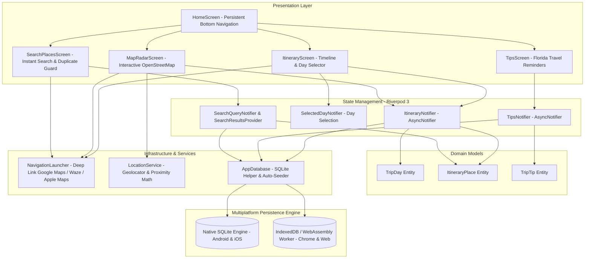
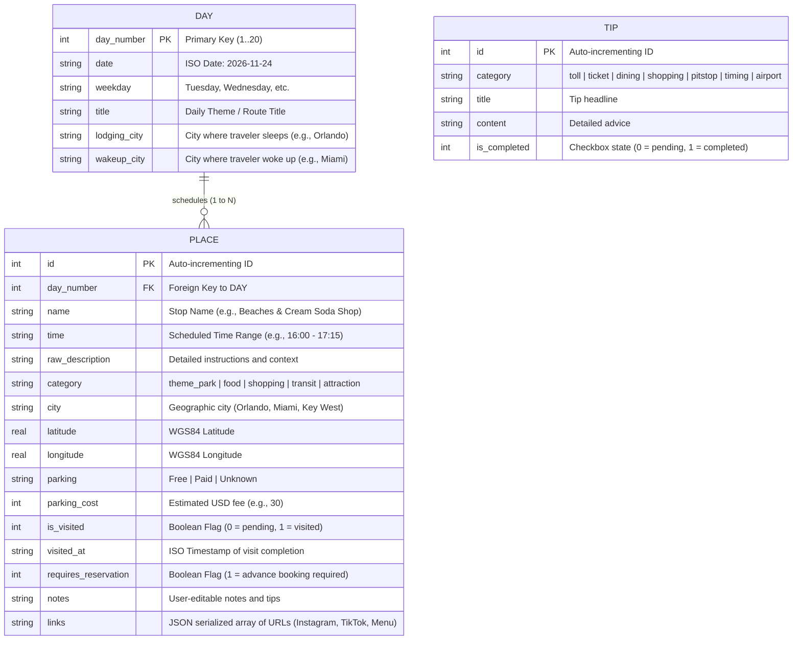
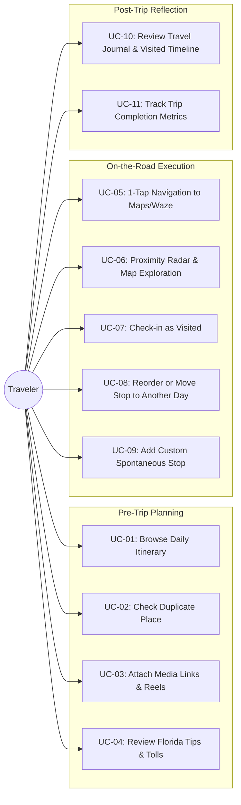
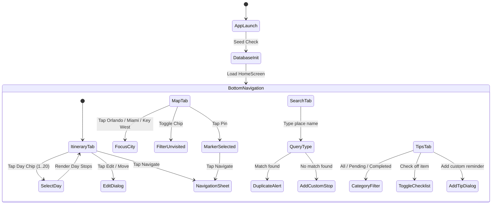
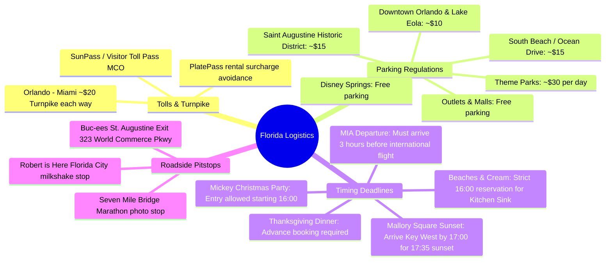

# 🌴 Florida Trip Companion - Technical & Functional Specification

> **Project Name**: Florida Trip Companion (`florida_trip`)  
> **Target Audience**: Travelers embarking on multi-destination road trips across Florida (Miami, Orlando, Tampa, St. Augustine, and the Florida Keys).  
> **Platforms**: Android (Primary Target), iOS (Production Target), Web/Chrome (Development & Preview).  
> **Version**: 1.0.0  
> **License**: MIT  

---

## 1. Executive Summary & Context

Planning and executing a complex 20-day international road trip involves high cognitive load: coordinating theme park opening hours, dining reservations, toll plazas, parking regulations, and changing weather conditions. 

The **Florida Trip Companion** mobile application provides an **offline-first, zero-friction travel assistant** designed for all three phases of travel:
1. **Pre-Trip**: Visualizing the day-by-day plan, verifying if places are already added, attaching inspiration reels (Instagram/TikTok/YouTube), and tracking preparation checklists.
2. **On-the-Road (During Trip)**: Rapid one-tap native GPS navigation (Google Maps, Waze, Apple Maps), proximity radar to discover scheduled spots nearby, visited check-ins, and parking cost awareness.
3. **Post-Trip**: Reliving the journey through a chronologically structured journal with trip completion metrics.

---

## 2. Trip Overview & Domain Metadata

The app comes pre-seeded with a comprehensive 20-day Florida road trip itinerary:

| Day | Date | Day of Week | Primary Focus | Overnight Lodging | Wakeup City | Key Highlights |
| :---: | :---: | :---: | :--- | :--- | :--- | :--- |
| **1** | 2026-11-24 | Tuesday | Miami Arrival → Boca Raton → Orlando | Orlando | Miami | MIA Airport, Boca Town Center (Apple Store), Costco, Walmart, Turnpike (~$20 toll) |
| **2** | 2026-11-25 | Wednesday | Orlando Acclimatization & Outlets | Orlando | Orlando | International Drive, ICON Park, Shake Shack, Orlando Outlet Marketplace, Five Below, Miller's Ale House |
| **3** | 2026-11-26 | Thursday | Thanksgiving + SeaWorld | Orlando | Orlando | SeaWorld Orlando, Thanksgiving Themed Dinner Experience |
| **4** | 2026-11-27 | Friday | Black Friday Shopping Blitz | Orlando | Orlando | Orlando International Premium Outlets, Florida Mall, Chick-fil-A, Cracker Barrel Old Country Store |
| **5** | 2026-11-28 | Saturday | Tampa Bay + Celebration | Orlando | Orlando | Busch Gardens Tampa Bay, Celebration *Now Snowing* Christmas lights |
| **6** | 2026-11-29 | Sunday | Lake Eola & Downtown Orlando | Orlando | Orlando | Lake Eola Sunday Farmers Market, Downtown Orlando, Wendy's, Little Caesars |
| **7** | 2026-11-30 | Monday | Magic Kingdom | Orlando | Orlando | Full day at Magic Kingdom |
| **8** | 2026-12-01 | Tuesday | Mickey's Very Merry Christmas Party | Orlando | Orlando | Dollar Tree, GameStop, Wawa, Magic Kingdom Christmas Party (16:00 – 00:00) |
| **9** | 2026-12-02 | Wednesday | Winter Garden + Disney Springs Sunset | Orlando | Orlando | Historic Downtown Winter Garden, Five Guys, Disney Springs sunset, Shake Shack |
| **10** | 2026-12-03 | Thursday | Disney's Hollywood Studios | Orlando | Orlando | Hollywood Studios full day (Star Wars Galaxy's Edge, Tower of Terror) |
| **11** | 2026-12-04 | Friday | Grand Disney Resorts Crawl | Orlando | Orlando | Disney Springs, Art of Animation Skyliner, Beaches & Cream (Kitchen Sink Sundae @ 16h), BoardWalk, Fort Wilderness Campfire |
| **12** | 2026-12-05 | Saturday | Historic St. Augustine + Buc-ee's | Orlando | Orlando | Buc-ee's World Commerce Pkwy (brisket & snacks), Castillo de San Marcos, Nights of Lights |
| **13** | 2026-12-06 | Sunday | Winter Garden & Light Shopping | Orlando | Orlando | Winter Garden Historic District, Target, Chick-fil-A |
| **14** | 2026-12-07 | Monday | Universal Studios + Islands of Adventure | Orlando | Orlando | Universal 2-park park-to-park marathon |
| **15** | 2026-12-08 | Tuesday | Recovery & Flexibility Day | Orlando | Orlando | Rest morning, Vineland Outlets, Old Town Kissimmee |
| **16** | 2026-12-09 | Wednesday | Universal's Epic Universe | Orlando | Orlando | Full day at Universal's brand new Epic Universe theme park |
| **17** | 2026-12-10 | Thursday | CityWalk & Portofino Bay Water Taxi | Orlando | Orlando | Outlets, Universal CityWalk Water Taxi to Loews Portofino Bay Hotel, Toothsome Chocolate Emporium |
| **18** | 2026-12-11 | Friday | Orlando → Miami South Beach | Miami | Orlando | Palm Beach coast stop, Wynwood Walls urban art, Little Havana (Calle Ocho), South Beach / Ocean Drive |
| **19** | 2026-12-12 | Saturday | Overseas Highway → Key West Sunset | Key West | Miami | Robert is Here, Key Largo, Blond Giraffe Key Lime Pie, Robbie's Marina, Seven Mile Bridge, Mallory Square sunset (@ 17:35), Duval St |
| **20** | 2026-12-13 | Sunday | Key West → Miami Airport (MIA) | Departure | Key West | Southernmost Point Buoy, Fort Zachary Taylor State Park, Overseas Highway drive back, MIA Airport return (3h buffer) |

---

## 3. High-Level Architecture & Tech Stack

The system follows **Clean Architecture** paired with a **Feature-First** modular decomposition in strictly typed Dart:

### Technology Selection Rationale

| Layer | Component | Choice | Rationale |
| :--- | :--- | :--- | :--- |
| **UI Framework** | Flutter 3.47+ / Dart 3.13+ | Cross-platform | 60/120 FPS native performance, single codebase for Android APK and iOS IPA. |
| **State Management** | `flutter_riverpod: ^3.4.3` | Compile-safe reactivity | Riverpod 3 Notifiers provide clean lifecycle control without memory leaks. |
| **Local Database** | `sqflite` + `sqflite_common_ffi_web` | Offline-First Relational DB | Sub-5ms query latency, zero cloud dependency, runs via native C/C++ SQLite on Android/iOS and WebAssembly Worker on Web. |
| **Mapping** | `flutter_map: ^8.3.2` + `latlong2` | OpenStreetMap Vector Tiles | No paid Google Maps API keys required, zero billing friction, responsive touch gestures. |
| **Geolocation** | `geolocator: ^14.1.2` | Native GPS | Computes exact distance from traveler to every stop in meters and kilometers. |
| **Navigation Intents** | `url_launcher: ^6.3.3` | Deep-linking | Dispatches standard `geo:`, `google.navigation:`, `waze://`, and Apple Maps URI schemes. |

---

## 4. Entity-Relationship Model (Database Schema)

All data is stored locally in relational tables with indexes on search-heavy fields:

---

## 5. Functional Use Cases

### Detailed Use Case Specifications

#### UC-01: Browse Daily Itinerary
- **Actor**: Traveler.
- **Trigger**: Opening the app or tapping the **Itinerary** tab.
- **Preconditions**: App database initialized.
- **Normal Flow**:
  1. System displays horizontal chip selector for Day 1 through Day 20.
  2. System presents the Lodging Banner (`Lodging tonight: City`, with wake-up city note if different).
  3. System renders a timeline of scheduled stops with time badge, category icon, parking info, and visited status.
  4. Top AppBar displays a progress counter: `X/Y Visited`.

#### UC-02: Duplicate Prevention & Search
- **Actor**: Traveler.
- **Trigger**: Typing in the **Search** tab.
- **Normal Flow**:
  1. Traveler inputs a query (e.g., *"Beaches & Cream"* or *"Outlet"*).
  2. System executes an indexed SQLite search against `name`, `raw_description`, `city`, and `notes`.
  3. If match exists: displays an emerald banner `Found X matching stop(s) already in itinerary!` showing the exact day and time scheduled.
  4. If match does not exist: displays a warning banner confirming the item is not yet scheduled, offering an instant *"Add Custom Stop"* button.

#### UC-03: One-Tap Route Navigation
- **Actor**: Traveler in vehicle.
- **Trigger**: Tapping **"Navigate"** on any place card or map popup.
- **Normal Flow**:
  1. System opens a bottom sheet with direct options:
     - **Google Maps**: Launches `https://www.google.com/maps/dir/?api=1&destination=lat,lng`.
     - **Waze**: Launches `https://waze.com/ul?ll=lat,lng&navigate=yes`.
     - **Apple Maps** (iOS only): Launches `http://maps.apple.com/?daddr=lat,lng`.
  2. The selected navigation app opens with the exact coordinates pre-filled from current device GPS.

#### UC-04: Proximity Radar & Interactive Map
- **Actor**: Traveler.
- **Trigger**: Selecting the **Map Radar** tab.
- **Normal Flow**:
  1. System renders OpenStreetMap with all geocoded itinerary pins.
  2. Pins for visited locations appear in muted slate with a checkmark; unvisited appear in vibrant teal/orange.
  3. Traveler can toggle the filter chip **"Only Unvisited"** to declutter the map.
  4. Traveler can tap quick-focus chips (**Orlando**, **Miami**, **Key West**) to instantly pan the camera.
  5. Traveler can tap **My Location** to center the map on their current GPS coordinates.
  6. Tapping any pin presents a preview card with stop name, day/time, description, and **Navigate** button.

#### UC-05: Visited Check-in & Timestamping
- **Actor**: Traveler.
- **Trigger**: Tapping the **Mark Visited** button on a card.
- **Normal Flow**:
  1. System toggles `is_visited` to `1` and records `visited_at = DateTime.now()`.
  2. Card transitions with visual feedback (strikethrough text, muted colors, emerald checkmark).
  3. Daily progress counter increments.
  4. Corresponding map marker turns from teal to muted slate.

#### UC-06: Rescheduling / Moving a Stop
- **Actor**: Traveler (due to weather, crowds, or fatigue).
- **Trigger**: Tapping **Edit** on a place card.
- **Normal Flow**:
  1. System opens `PlaceEditDialog`.
  2. Traveler changes the scheduled day dropdown (e.g., from Day 14 to Day 15).
  3. Traveler adjusts time or adds notes (e.g., *"Postponed due to afternoon thunderstorm"*).
  4. System updates SQLite and refreshes both the timeline and search cache.

---

## 6. User Journey & Navigation Architecture

---

## 7. Critical Florida Travel Knowledge & Field Nuances

The application incorporates domain-specific Florida logistics rules:

---

## 8. Security, Permissions & Multiplatform Configurations

### 8.1 Android Configuration (`AndroidManifest.xml`)
- **Permissions**:
  - `android.permission.INTERNET`: Tile downloads and external link launches.
  - `android.permission.ACCESS_FINE_LOCATION`: Real-time proximity calculation.
  - `android.permission.ACCESS_COARSE_LOCATION`: Battery-friendly cell location.
- **Package Visibility (`<queries>`)**:
  - Declares intent filters for `geo:`, `google.navigation:`, `waze:`, and `https:` to support Android 11+ package visibility restrictions.

### 8.2 iOS Configuration (`Info.plist`)
- **Permissions**:
  - `NSLocationWhenInUseUsageDescription`: Displays descriptive prompt explaining location usage for itinerary distances.
- **URL Schemes (`LSApplicationQueriesSchemes`)**:
  - Whitelists `comgooglemaps`, `waze`, `maps`, and `https`.

### 8.3 Web / Desktop Engine
- Uses `sqflite_common_ffi_web` with dedicated `sqflite_sw.js` (Web Worker) and `sqlite3.wasm` (WebAssembly binary) for zero-dependency local IndexedDB execution in Google Chrome.

---

## 9. Verification & Code Quality Metrics

| Check | Tool | Result |
| :--- | :--- | :--- |
| **Static Analysis** | `flutter analyze` | **0 errors, 0 warnings, 0 lints** |
| **Unit / Widget Tests** | `flutter test` | **All tests passed** (`test/widget_test.dart`) |
| **Web Build** | `flutter build web` | **✓ Built `build\web`** (Production ready) |
| **Source Control** | Git | Clean working tree on `master` branch |

---

## 10. Future Roadmap (Post-Trip & Release)

- [ ] **Photo Gallery Auto-Matcher**: Integrate `photo_manager` to scan local device camera roll for photos matching the exact GPS coordinates and timestamps of completed itinerary stops.
- [ ] **Travel Expense Ledger**: Sub-tracker for gas, toll, dining, and souvenir costs in USD with BRL conversion.
- [ ] **Offline Tile Pack**: Pre-caching OpenStreetMap vector tiles for areas with poor cellular reception (e.g., sections of the Overseas Highway).
